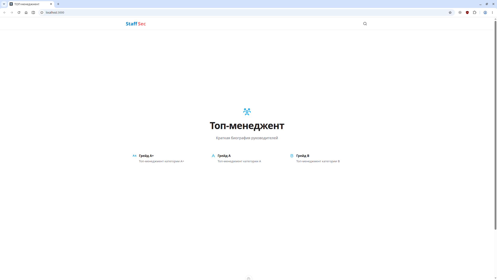
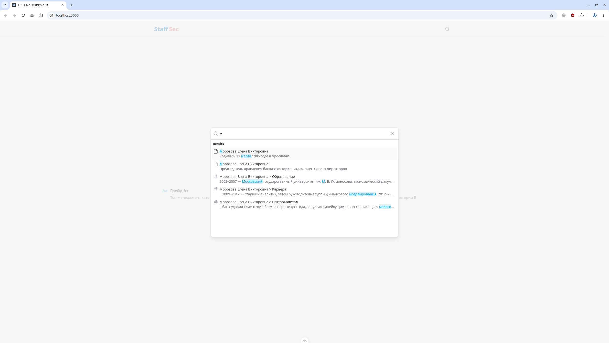
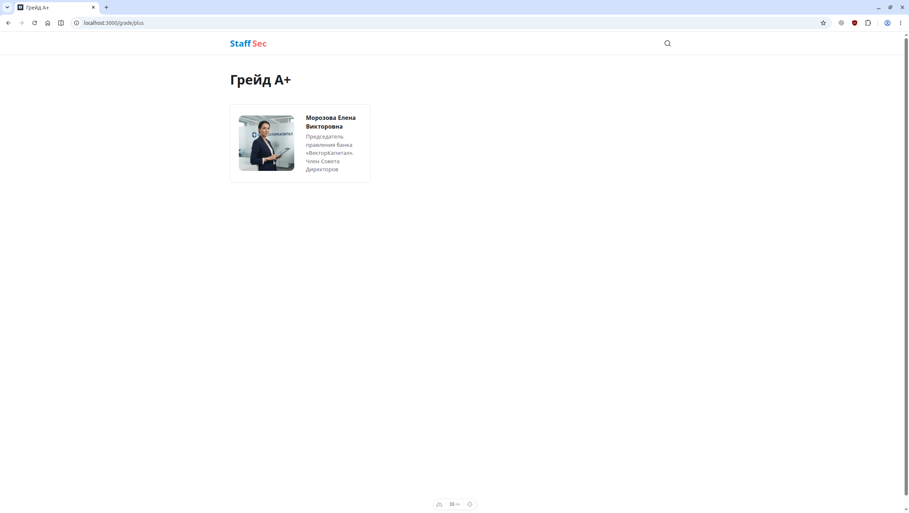
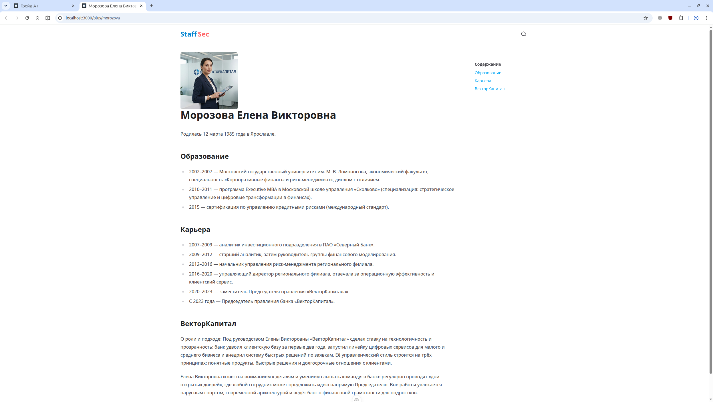

# Person Content

Контент-сайт с краткими биографиями топ-менеджмента.
Персоны разделены на грейды **А+**, **А** и **B**.
Rаждый грейд — отдельная коллекция Markdown-файлов, управляемая через [Nuxt Content](https://content.nuxt.com).

## Стек

- [Nuxt 4](https://nuxt.com) — Vue-based SSR-фреймворк
- [@nuxt/content 3](https://content.nuxt.com) — контент на Markdown с SQLite-базой
- [@nuxt/ui 4](https://ui.nuxt.com) — UI-компоненты
- [Tailwind CSS 4](https://tailwindcss.com) — стилизация
- [Valibot](https://valibot.dev) - схема коллекций
- [Bun](https://bun.sh) — пакетный менеджер и рантайм

## Структура проекта

```
├── app/
│   ├── assets/css/main.css         # Глобальные стили
│   ├── app.config.ts               # Конфигурация приложения (тема Nuxt UI)
│   ├── app.vue                     # Корневой компонент
│   └── pages/
│       ├── index.vue               # Главная: выбор грейда (А+, А, B)
│       ├── grade/[collection].vue  # Список персон грейда (collection = a | b | plus)
│       └── [collection]/[name].vue # Страница биографии конкретной персоны
├── content/
│   └── plus/                       # Коллекция «plus»: биографии грейда А+
│       └── morozova.md
├── public/
│   └── plus/                       # Фотографии персон (public/<collection>/<name>.png)
│       └── morozova.png
├── content.config.ts               # Определение коллекций контента (a, b, plus)
├── nuxt.config.ts                  # Конфигурация Nuxt
└── shared/types/index.ts           # типы данных
```

## Коллекции контента

В [`content.config.ts`](content.config.ts) определены три коллекции типа `page`:

| Коллекция | Источник           | Грейд   | Маршрут          |
| --------- | ------------------ | ------- | ---------------- |
| `plus`    | `content/plus/`    | А+      | `/grade/plus`    |
| `a`       | `content/a/`       | А       | `/grade/a`       |
| `b`       | `content/b/`       | B       | `/grade/b`       |
| `archive` | `content/archive/` | Archive | `/grade/archive` |

### Формат файла биографии

Каждая персона — Markdown-файл с frontmatter:

```markdown
---
title: "Фамилия Имя Отчество"
description: "Должность, короткое описание"
date: 2026-11-01
---

## Образование

- ...

## Карьера

- ...
```

Биография персоны добавляется в `content/<collection>/<name>.md`.
Фотография персоны добавляется в `public/<collection>/<name>.png`.

## Запуск

Требуется [Bun](https://bun.sh) и [Node.js 24+](https://nodejs.org/en).

```bash
# Клонирование репозитория
git clone https://github.com/waldesem/Person-Content.git
cd Person-Content
# Установка зависимостей
bun install

# Режим разработки — http://localhost:3000
bun run dev
```

## Продакшен

```bash
# Сборка
bun run build

# Запуск сервера
node .output/server/index.mjs
# Listening on http://localhost:3000
```

## Продакшен с Docker

```bash
# Сборка
docker build -t person-content .

# Запуск контейнера
docker run -p 3000:3000 person-content
```

## Добавление новой персоны

- На одной из страниц `grade` загрузите файл `<name>.md` с (`title`, `description`, `date`) и текстом биографии.
- Персона автоматически появится в списке соответствующего грейда.
- На странице `grade/<name>.md` добавьте фотографию.
- Перезапустите сервер (если используете Docker - перезапустите контейнер).

## Скриншоты





