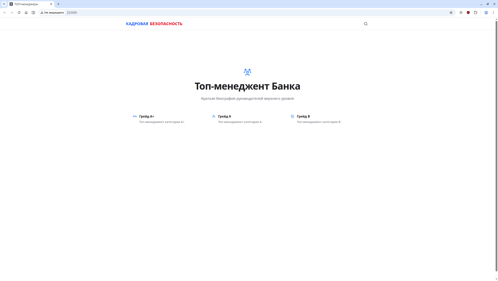
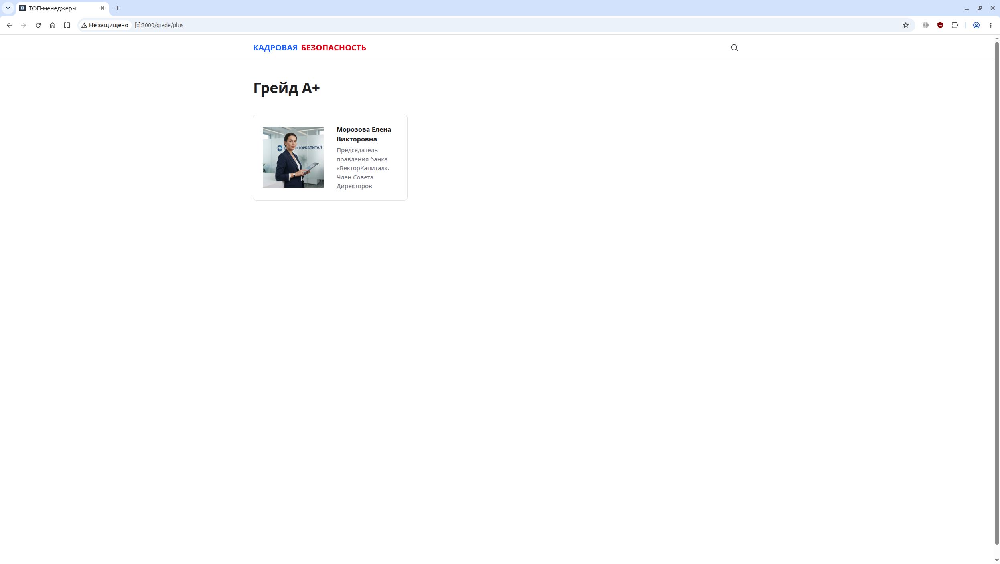
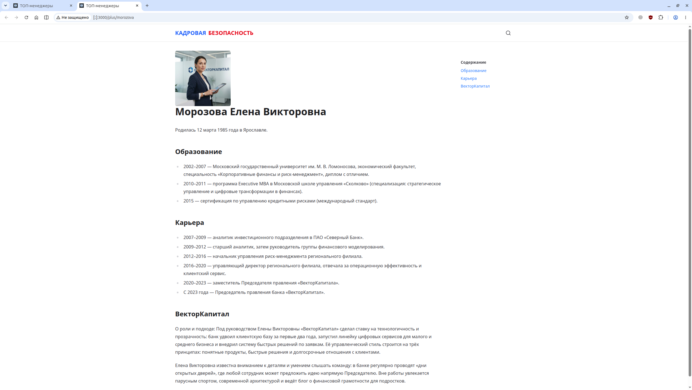

# Person Content

Контент-сайт с краткими биографиями топ-менеджмента банка.
Персоны разделены на грейды **А+**, **А** и **B**.
Rаждый грейд — отдельная коллекция Markdown-файлов, управляемая через [Nuxt Content](https://content.nuxt.com).

## Стек

- [Nuxt 4](https://nuxt.com) — фреймворк (SSR + prerender главной страницы)
- [@nuxt/content 3](https://content.nuxt.com) — контент-слой на Markdown с SQLite-базой
- [@nuxt/ui 4](https://ui.nuxt.com) — компоненты (`UPage`, `UPageCard`, `UPageSection` и т.д.)
- [Tailwind CSS 4](https://tailwindcss.com) — стилизация
- [Bun](https://bun.sh) — пакетный менеджер и рантайм
- ESLint (@nuxt/eslint, стилистический конфиг) и vue-tsc — качество кода

## Структура проекта

```
├── app/
│   ├── assets/css/main.css     # Глобальные стили
│   ├── app.config.ts           # Конфигурация приложения (тема Nuxt UI)
│   ├── app.vue                 # Корневой компонент
│   └── pages/
│       ├── index.vue           # Главная: выбор грейда (А+, А, B)
│       ├── grade/[slug].vue    # Список персон грейда (slug = a | b | plus)
│       └── [...slug].vue       # Страница биографии конкретной персоны
├── content/
│   └── plus/                   # Коллекция «plus»: биографии грейда А+
│       └── 1.morozova.md
├── public/
│   └── plus/                   # Фотографии персон (public/<collection>/<slug>.png)
├── content.config.ts           # Определение коллекций контента (a, b, plus)
└── nuxt.config.ts              # Конфигурация Nuxt
```

## Коллекции контента

В [`content.config.ts`](content.config.ts) определены три коллекции типа `page`:

| Коллекция | Источник        | Грейд | Маршрут списка |
| --------- | --------------- | ----- | -------------- |
| `plus`    | `content/plus/` | А+    | `/grade/plus`  |
| `a`       | `content/a/`    | А     | `/grade/a`     |
| `b`       | `content/b/`    | B     | `/grade/b`     |

### Формат файла биографии

Каждая персона — Markdown-файл с frontmatter:

```markdown
---
title: "Фамилия Имя Отчество"
description: "Должность, короткое описание"
date: 2026-11-01
---

.png" width="200" height="100" alt="">

# Фамилия Имя Отчество

## Образование

- ...

## Карьера

- ...
```

Фотография персоны кладётся в `public/<collection>/<slug>.png` и автоматически подставляется в карточку на странице грейда.

## Запуск

Требуется [Bun](https://bun.sh) (или Node.js 20+).

```bash
# Клонирование репозитория
git clone https://github.com/waldesem/Person-Content.git
cd person-content
# Установка зависимостей
bun install

# Режим разработки — http://localhost:3000
bun run dev
```

## Продакшен

```bash
# Сборка
bun run build

# Запуск сервера
node .output/server/index.mjs
# Listening on http://localhost:3000
```

Предпросмотр собранной версии: `bun run preview`.

Главная страница (`/`) пререндерится при сборке (см. `routeRules` в [`nuxt.config.ts`](nuxt.config.ts)).

## Добавление новой персоны

1. Создайте файл `content/<коллекция>/<номер>.<slug>.md` с frontmatter (`title`, `description`, `date`) и текстом биографии.
2. Добавьте фотографию `public/<коллекция>/<slug>.png`.
3. Персона автоматически появится в списке соответствующего грейда.

## Разработка

- **Линт**: ESLint настроен через `@nuxt/eslint` со стилистическими правилами (без висячих запятых, стиль скобок `1tbs`).
- **Nuxt DevTools** включены в режиме разработки.
- База контента — SQLite (переменная окружения `SQLITE_DB_LOCATION`).

## Скриншоты




